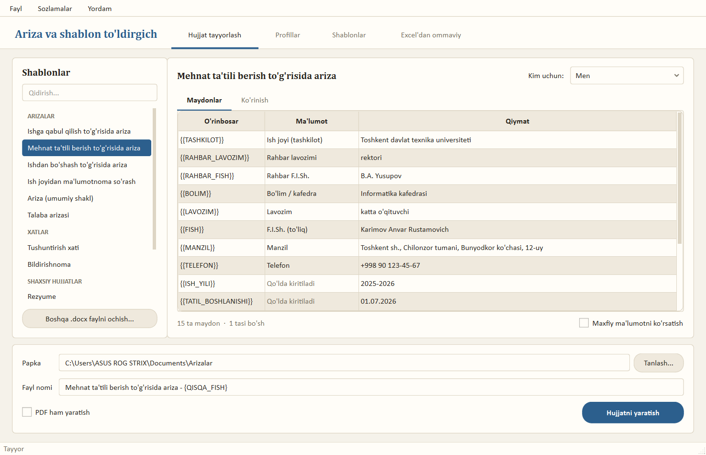
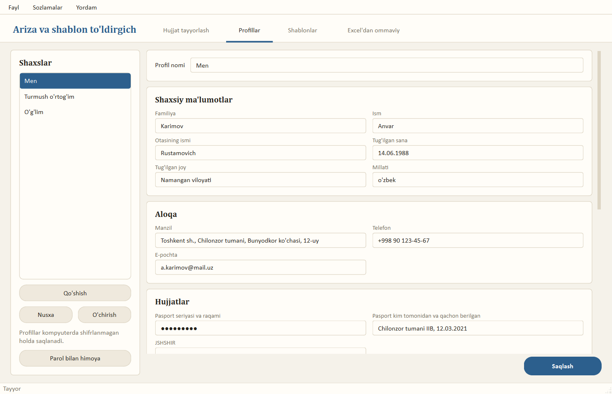
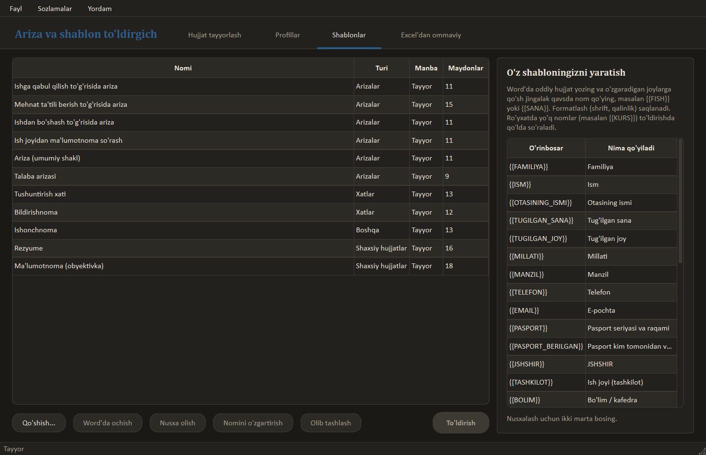
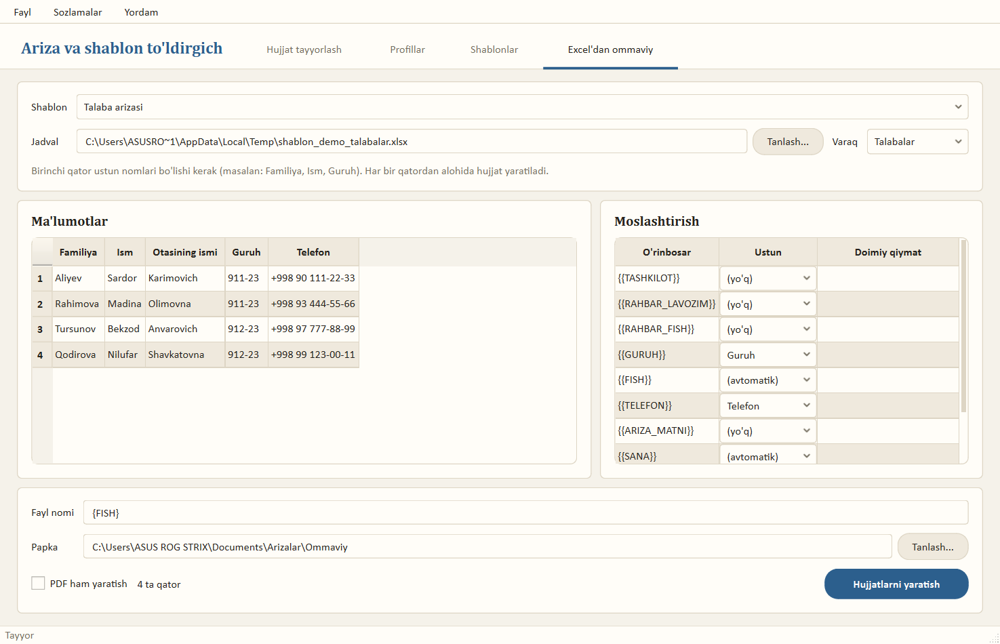

<p align="center"></p>

<h1 align="center">Ariza va shablon to'ldirgich</h1>
<p align="center"><b>Template Filler</b> · Заполнение заявлений и шаблонов</p>

<p align="center">
  <a href="https://github.com/eduhakimov/shablon-toldirgich/releases/latest/download/ShablonToldirgich.exe"></a><br>
  
  
  
  
</p>

Word (.docx) shablonlarini saqlangan shaxsiy ma'lumotlar bilan to'ldiruvchi oflayn dastur: profillar, tayyor o'zbekcha arizalar, formatni saqlab to'ldirish, PDF va Excel'dan ommaviy yaratish.






## Imkoniyatlar

- Bir nechta profil (o'zingiz, oila a'zolari): F.I.Sh., tug'ilgan sana, manzil, pasport, JSHSHIR va boshqalar
- Profillarni parol bilan shifrlash (AES, Fernet)
- Shablondagi {{O'RINBOSAR}} larni avtomatik topish va profil maydonlariga moslash
- Formatni saqlab to'ldirish: bo'lingan runlar, jadvallar, kolontitullar, matn bloklari
- 11 ta tayyor shablon: ishga qabul, ta'til, ishdan bo'shash, ma'lumotnoma, tushuntirish xati, bildirishnoma, ishonchnoma, rezyume, obyektivka va boshqalar
- Microsoft Word orqali PDF
- Excel/CSV jadvalidan ommaviy yaratish
- Shablonlar kutubxonasi
- To'liq oflayn; o'zbek, rus, ingliz tillari

## Shablon yozish

Word hujjatida o'zgaradigan joylarga `{{NOM}}` qo'ying: `{{FISH}}`, `{{QISQA_FISH}}`, `{{SANA}}`,
`{{MANZIL}}`, `{{TELEFON}}`, `{{PASPORT}}`, `{{JSHSHIR}}`, `{{TASHKILOT}}`, `{{LAVOZIM}}`, `{{RAHBAR_FISH}}` va h.k.
To'liq ro'yxat dasturning **Shablonlar** bo'limida. Boshqa nomlar to'ldirishda qo'lda so'raladi.

O'rinbosar Word ichida bir nechta bo'lakka (run) bo'lingan bo'lsa ham topiladi; jadvallar, kolontitullar,
izohlar va matn bloklari ham to'ldiriladi. Qiymat o'rinbosar boshlangan joydagi formatni oladi.

## Ma'lumotlar qayerda saqlanadi

`%APPDATA%\BahtiyorSoft\shablon-toldirgich\` papkasida: `profiles.json` (parol qo'yilgan bo'lsa Fernet/AES
bilan shifrlangan, kalit PBKDF2-SHA256 orqali paroldan olinadi) va `templates\` (siz qo'shgan shablonlar nusxasi).
Internetga hech narsa yuborilmaydi.

## Manba koddan ishga tushirish

```
python -m pip install PySide6 python-docx openpyxl cryptography pywin32
python tools/make_templates.py
python main.py
```


## O'rnatish

1. [**ShablonToldirgich.exe**](https://github.com/eduhakimov/shablon-toldirgich/releases/latest/download/ShablonToldirgich.exe) faylini yuklab oling.
2. Faylni ishga tushiring, o'rnatish shart emas.
3. Windows SmartScreen ogohlantirsa: **Batafsil → Baribir ishga tushirish**.

**Tizim talablari:** Windows 10 (1809+) / Windows 11, x64

---

## Русский

Офлайн-программа для заполнения шаблонов Word (.docx) сохранёнными личными данными: профили, готовые заявления на узбекском, заполнение с сохранением оформления, PDF и пакетное создание из Excel.

- Несколько профилей (вы, члены семьи): ФИО, дата рождения, адрес, паспорт, ПИНФЛ и др.
- Шифрование профилей паролем (AES, Fernet)
- Автоматический поиск полей {{ПОЛЕ}} и сопоставление с профилем
- Заполнение с сохранением оформления: разбитые фрагменты, таблицы, колонтитулы, надписи
- 11 готовых шаблонов: приём на работу, отпуск, увольнение, справка, объяснительная, докладная, доверенность, резюме, объективка и др.
- PDF через Microsoft Word
- Пакетное создание из таблицы Excel/CSV
- Библиотека шаблонов
- Полностью офлайн; узбекский, русский, английский

## English

An offline app that fills Word (.docx) templates with saved personal details: profiles, ready-made Uzbek applications, formatting-preserving fill, PDF export and batch generation from Excel.

- Several profiles (you, family members): name, birth date, address, passport, PINFL and more
- Optional password encryption of profiles (AES, Fernet)
- Finds {{PLACEHOLDERS}} automatically and maps them to profile fields
- Formatting-preserving fill: split runs, tables, headers/footers, text boxes
- 11 ready-made Uzbek templates: employment, leave, resignation, certificate request, explanatory note, memo, power of attorney, CV, obyektivka and more
- PDF via Microsoft Word
- Batch generation from an Excel/CSV sheet
- Template library
- Fully offline; Uzbek, Russian, English

---

## Muallif / Author

**Bahtiyorjon Hakimov** (Hakimov Bahtiyorjon Muzaffar o'g'li), [github.com/eduhakimov](https://github.com/eduhakimov)

© 2026 Bahtiyorjon Hakimov. Barcha huquqlar himoyalangan. / Все права защищены. / All rights reserved.
Batafsil: [LICENSE](LICENSE) · Uchinchi tomon komponentlari: [THIRD_PARTY_NOTICES.md](THIRD_PARTY_NOTICES.md)
