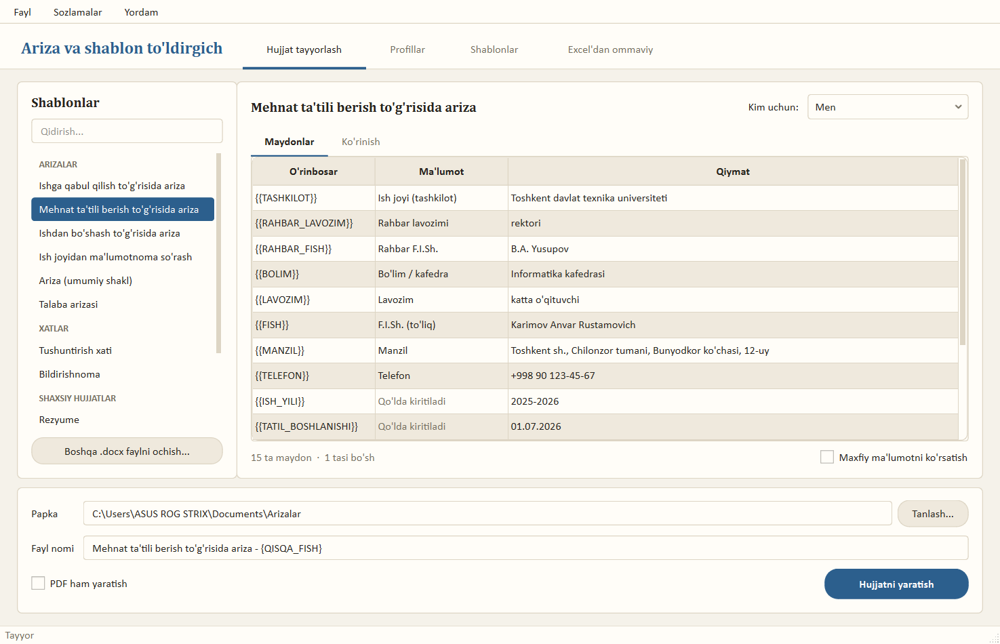
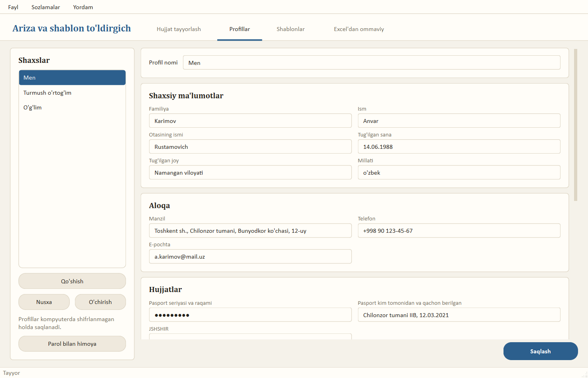
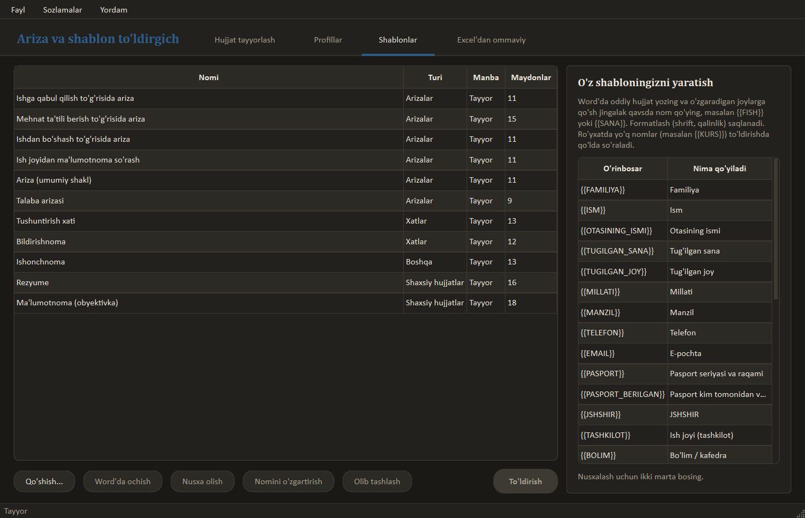
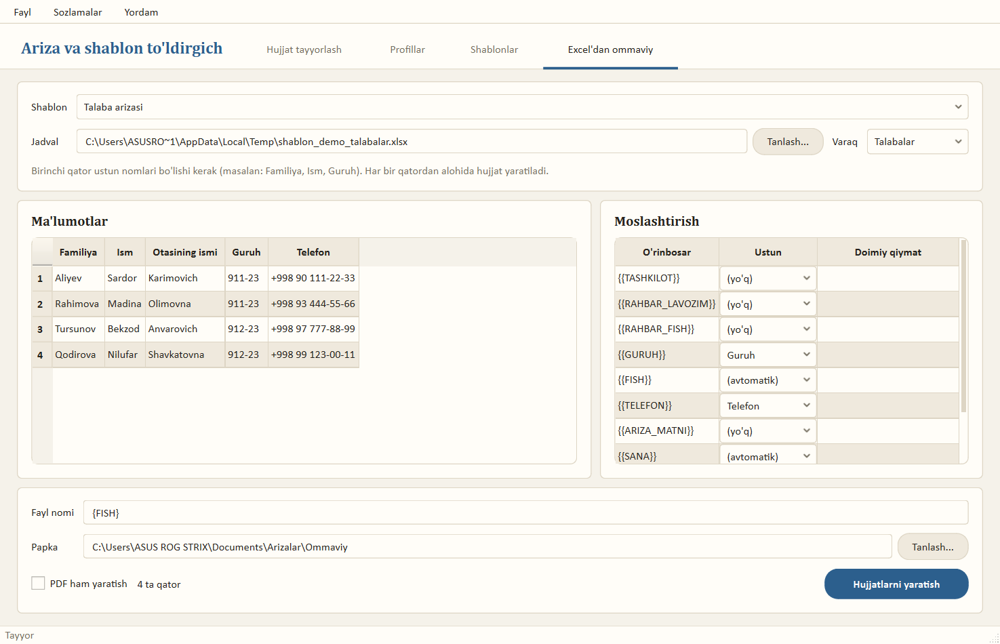

# Ariza va shablon to‘ldirgich: Foydalanish qo‘llanmasi

Muallif: Hakimov Bahtiyorjon. Versiya: 1.0.2.

## 1. Umumiy ma’lumot

“Ariza va shablon to‘ldirgich” – Word (.docx) shablonlarini siz saqlab qo‘ygan shaxsiy ma’lumotlar bilan avtomatik to‘ldiruvchi dastur. Siz bir marta o‘zingiz va oila a’zolaringiz haqidagi ma’lumotlarni (F.I.Sh., tug‘ilgan sana, manzil, telefon, pasport, JSHSHIR, ish joyi, lavozim va boshqalar) kiritasiz, keyin istalgan ariza yoki xatni bir necha bosishda tayyorlaysiz.

Dastur bilan 11 ta tayyor shablon keladi: “Ishga qabul qilish to‘g‘risida ariza”, “Mehnat ta’tili berish to‘g‘risida ariza”, “Ishdan bo‘shash to‘g‘risida ariza”, “Ish joyidan ma’lumotnoma so‘rash”, “Ariza (umumiy shakl)”, “Talaba arizasi”, “Tushuntirish xati”, “Bildirishnoma”, “Ishonchnoma”, “Rezyume” va “Ma’lumotnoma (obyektivka)”. O‘zingiz yaratgan Word shablonlarini ham qo‘shishingiz mumkin.

Bundan tashqari, dastur Excel yoki CSV jadvalining har bir qatori uchun alohida hujjat yaratadi. Bu imkoniyat, masalan, guruhdagi barcha talabalar yoki bo‘limdagi barcha xodimlar uchun bir xil hujjat tayyorlashda qo‘l keladi.

Dastur fuqarolar, talabalar, o‘qituvchilar, kafedra mudirlari, dekanat, kadrlar bo‘limi va devonxona xodimlari uchun mo‘ljallangan.

Dasturning asosiy afzalligi – ma’lumotlar bir marta kiritiladi. Masalan, ish joyingiz, lavozimingiz va rahbaringiz ma’lumotlari profilda saqlangan bo‘lsa, ta’til arizasi, ma’lumotnoma so‘rash arizasi va tushuntirish xati uchun ularni qayta yozish kerak emas. Sana har safar avtomatik yangilanadi.

## 2. Tizim talablari

- Operatsion tizim: Windows 10 (1809 yoki undan keyingi versiya) yoki Windows 11, 64 bitli (x64).
- Internet aloqasi talab qilinmaydi: dastur to‘liq oflayn ishlaydi va ma’lumotlarni hech qayerga yubormaydi.
- O‘rnatish shart emas: dastur bitta ShablonToldirgich.exe faylidan iborat.
- PDF yaratish uchun kompyuterda Microsoft Word yoki LibreOffice o‘rnatilgan bo‘lishi kerak. Ular bo‘lmasa, dastur faqat .docx fayl yaratadi.
- Shablonlarni tahrirlash va natijani ochish uchun .docx formatini ochadigan matn muharriri kerak.

## 3. O‘rnatish va ishga tushirish

1. Dasturning GitHub sahifasidagi Releases bo‘limidan (https://github.com/eduhakimov/shablon-toldirgich/releases) ShablonToldirgich.exe faylini yuklab oling.
2. Faylni o‘zingizga qulay papkaga ko‘chiring.
3. Faylni ikki marta bosib ishga tushiring. Dastur o‘rnatilmaydi, oyna darhol ochiladi.
4. Birinchi ishga tushirishda Windows SmartScreen ogohlantirish oynasini ko‘rsatishi mumkin. Bunday holda “Batafsil” havolasini, so‘ng “Baribir ishga tushirish” tugmasini bosing.
Yangi versiyaga o‘tish uchun eski .exe faylni yangisi bilan almashtiring. Profillar va siz qo‘shgan shablonlar alohida papkada saqlangani uchun ular yo‘qolmaydi.

## 4. Dastur oynasi bilan tanishish

Oyna yuqorisida menyu satri bor: “Fayl”, “Sozlamalar” (til va mavzu) va “Yordam” (“Qo‘llanma” va “Dastur haqida”). Uning ostida dastur nomi va to‘rtta bo‘lim yorlig‘i joylashgan: “Hujjat tayyorlash”, “Profillar”, “Shablonlar” va “Excel’dan ommaviy”. Oyna pastidagi holat satrida qisqa xabarlar chiqadi.

**Hujjat tayyorlash** (1-rasm). Chapda “Shablonlar” ro‘yxati toifalar bo‘yicha (“Arizalar”, “Xatlar”, “Shaxsiy hujjatlar”, “Boshqa”) va “Qidirish...” maydoni, pastda “Boshqa .docx faylni ochish...” tugmasi. O‘ngda “Kim uchun:” ro‘yxati, “Maydonlar” va “Ko‘rinish” varaqlari. “Maydonlar” jadvalida uchta ustun bor: “O‘rinbosar” (shablondagi nom), “Ma’lumot” (unga mos profil maydoni yoki “Qo‘lda kiritiladi”) va “Qiymat”. Pastki panelda “Papka”, “Fayl nomi”, “PDF ham yaratish” va “Hujjatni yaratish”.

**Profillar** (2-rasm). Chapda “Shaxslar” ro‘yxati va “Qo‘shish”, “Nusxa”, “O‘chirish”, “Parol bilan himoya” tugmalari. O‘ngda “Profil nomi” va maydonlar guruhlari: “Shaxsiy ma’lumotlar”, “Aloqa”, “Hujjatlar”, “Ish va o‘qish”, “Ariza kimga yoziladi (rahbar)”. Pastda “Saqlash” tugmasi.

**Shablonlar** (3-rasm). Jadvalda “Nomi”, “Turi”, “Manba” va “Maydonlar” ustunlari; pastda “Qo‘shish...”, “Word’da ochish”, “Nusxa olish”, “Nomini o‘zgartirish”, “Olib tashlash” va “To‘ldirish” tugmalari. O‘ngda “O‘z shabloningizni yaratish” yo‘riqnomasi va o‘rinbosarlar jadvali.

**Excel’dan ommaviy** (4-rasm). Yuqorida “Shablon”, “Jadval” va “Varaq” tanlovlari; o‘rtada “Ma’lumotlar” (jadval mazmuni) va “Moslashtirish” (“O‘rinbosar”, “Ustun”, “Doimiy qiymat”) jadvallari; pastda “Fayl nomi”, “Papka”, “PDF ham yaratish” va “Hujjatlarni yaratish”.

*1-rasm. “Hujjat tayyorlash” bo‘limi: chapda shablonlar ro‘yxati, o‘ngda “Mehnat ta’tili berish to‘g‘risida ariza” shablonining o‘rinbosarlari, ularga mos profil maydonlari va qiymatlari, pastda papka, fayl nomi va “Hujjatni yaratish” tugmasi*

*2-rasm. “Profillar” bo‘limi: “Shaxslar” ro‘yxati, “Shaxsiy ma’lumotlar”, “Aloqa” va “Hujjatlar” guruhlari; pasport raqami yashirin ko‘rinishda*

*3-rasm. “Shablonlar” bo‘limi (qorong‘i mavzu): 11 ta tayyor shablon turi va maydonlar soni bilan, o‘ngda “O‘z shabloningizni yaratish” bo‘yicha o‘rinbosarlar jadvali*

*4-rasm. “Excel’dan ommaviy” bo‘limi: “Talaba arizasi” shabloni, to‘rt qatorli jadval va o‘rinbosarlarni ustunlarga moslashtirish jadvali*

## 5. Asosiy amallar

**Profil yaratish**

1. “Profillar” bo‘limini oching va “Qo‘shish” tugmasini bosing.
2. “Profil nomi” maydoniga tushunarli nom yozing, masalan, “Men”, “Onam”, “O‘g‘lim”.
3. “Shaxsiy ma’lumotlar”, “Aloqa”, “Hujjatlar”, “Ish va o‘qish” guruhlaridagi maydonlarni to‘ldiring. Ariza yo‘llanadigan rahbar ma’lumotlarini “Ariza kimga yoziladi (rahbar)” guruhiga kiriting.
4. “Saqlash” tugmasini bosing. Holat satrida “Saqlandi” yozuvi chiqadi.
5. Profilni o‘chirish uchun uni ro‘yxatda tanlab, “O‘chirish” tugmasini bosing va so‘rovni tasdiqlang. O‘chirilgan profilni tiklab bo‘lmaydi.
Pasport raqami ikki harf va yetti raqamdan, JSHSHIR esa 14 raqamdan iborat bo‘lmasa, dastur ogohlantiradi. Oila a’zolari uchun profil yaratishda “Nusxa” tugmasidan foydalanish qulay: umumiy ma’lumotlar (manzil, telefon) ko‘chiriladi, faqat farqli maydonlarni o‘zgartirasiz.

**Tayyor shablon bo‘yicha hujjat tayyorlash**

1. “Hujjat tayyorlash” bo‘limida chapdagi ro‘yxatdan shablonni tanlang yoki “Qidirish...” maydoniga nomini yozing.
2. “Kim uchun:” ro‘yxatidan profilni tanlang. Profilga mos qatorlar avtomatik to‘ladi.
3. “Ma’lumot” ustunida “Qo‘lda kiritiladi” deb ko‘rsatilgan qatorlarning “Qiymat” katagini to‘ldiring, masalan, ta’til boshlanish sanasi yoki ish yili.
4. “Ko‘rinish” varag‘ida tayyor hujjat matnini o‘qib chiqing.
5. “Papka” maydonida saqlash joyini (“Tanlash...” tugmasi orqali) va “Fayl nomi” namunasini belgilang.
6. Kerak bo‘lsa “PDF ham yaratish” bayrog‘ini belgilang.
7. “Hujjatni yaratish” tugmasini bosing. Bo‘sh maydonlar qolgan bo‘lsa, dastur ularni sanab, davom etishni so‘raydi.
8. Holat satridagi “Yaratildi” xabaridan so‘ng faylni “Ochish” orqali ko‘ring.
Fayl nomi namunasida {FISH}, {SANA} kabi bitta jingalak qavsdagi nomlar qiymat bilan almashtiriladi. Papkada shu nomli fayl bo‘lsa, yangi faylga “(2)” qo‘shiladi, mavjud fayl ustiga yozilmaydi.

**O‘z shabloningizni yaratish va qo‘shish**

1. Word’da oddiy hujjat yozing. O‘zgaradigan joylarga qo‘sh jingalak qavsda nom qo‘ying, masalan, {{FISH}}, {{SANA}}, {{MANZIL}}, {{TELEFON}}, {{TASHKILOT}}, {{LAVOZIM}}, {{GURUH}}.
2. Mavjud nomlarning to‘liq ro‘yxati “Shablonlar” bo‘limining o‘ng panelida keltirilgan; nomni ikki marta bossangiz, u nusxalanadi.
3. Ro‘yxatda yo‘q nom (masalan, {{KURS}}) ham ishlatilishi mumkin: to‘ldirishda uning qiymati qo‘lda so‘raladi va keyingi safar eslab qolinadi.
4. Faylni .docx formatida saqlang.
5. “Shablonlar” bo‘limida “Qo‘shish...” tugmasini bosib, faylni tanlang. Fayl kutubxonaga nusxalanadi.
Shrift, qalinlik, jadval va kolontitullardagi formatlash to‘ldirishda saqlanadi. Bir martalik hujjat uchun faylni kutubxonaga qo‘shmasdan “Boshqa .docx faylni ochish...” orqali ham to‘ldirish mumkin.

**Excel’dan ommaviy yaratish**

1. Excel faylining birinchi qatoriga ustun nomlarini yozing, masalan, “Familiya”, “Ism”, “Otasining ismi”, “Guruh”, “Telefon”. Har bir keyingi qator bitta shaxs.
2. “Excel’dan ommaviy” bo‘limida “Shablon” ro‘yxatidan shablonni tanlang.
3. “Jadval” qatoridagi “Tanlash...” tugmasi orqali .xlsx yoki .csv faylni tanlang. Excel faylida bir nechta varaq bo‘lsa, “Varaq” ro‘yxatidan keraklisini belgilang.
4. “Moslashtirish” jadvalida har bir o‘rinbosarga tanlangan ustunni tekshiring. “(avtomatik)” – qiymat hisoblanadi (masalan, to‘liq F.I.Sh.), “(yo‘q)” – ustun topilmagan.
5. Barcha hujjatlarda bir xil bo‘ladigan qiymatni (masalan, tashkilot nomi) “Doimiy qiymat” ustuniga yozing.
6. “Fayl nomi” namunasini (masalan, {FISH}) va “Papka” ni belgilang, kerak bo‘lsa “PDF ham yaratish” ni yoqing.
7. “Hujjatlarni yaratish” tugmasini bosing. Natijada nechta hujjat yaratilgani haqida xabar chiqadi.
**Shablonlar kutubxonasini boshqarish**

- “Word’da ochish” – shablonni Word’da ko‘rish yoki tahrirlash uchun ochadi.
- “Nusxa olish” – tayyor shablondan o‘zingiz o‘zgartira oladigan nusxa yaratadi.
- “Nomini o‘zgartirish” va “Olib tashlash” – siz qo‘shgan shablonlar uchun.
- “To‘ldirish” – tanlangan shablonni “Hujjat tayyorlash” bo‘limida ochadi.
**Tayyor hujjatni tekshirish**

1. Yaratilgan faylni “Ochish” tugmasi yoki papka orqali oching.
2. F.I.Sh., sana, manzil va rahbar ma’lumotlari to‘g‘ri joyda ekanini tekshiring.
3. Hujjatda {{...}} ko‘rinishidagi to‘ldirilmagan joy qolmaganiga ishonch hosil qiling.
4. Kerak bo‘lsa hujjatni Word’da qo‘lda tahrirlang, so‘ng chop eting va imzolang.

## 6. Sozlamalar

- **Til.** “Sozlamalar” menyusidagi “Til” bandidan “O‘zbekcha”, “Русский” yoki “English” ni tanlang. Tilni o‘zgartirish uchun dastur qayta ishga tushiriladi.
- **Mavzu.** “Sozlamalar” – “Mavzu” bandidan “Yorug‘”, “Qorong‘i” yoki “Tizim bo‘yicha” ni tanlang (3-rasmda qorong‘i mavzu).
- **Parol bilan himoya.** “Profillar” bo‘limidagi “Parol bilan himoya” tugmasi orqali “Parol qo‘yish...”, “Parolni o‘zgartirish...” yoki “Parolni olib tashlash” amallarini bajaring. Parol ikki marta kiritiladi.
- **Eslab qolinadigan qiymatlar.** Oxirgi tanlangan profil, saqlash papkasi, “PDF ham yaratish” holati va qo‘lda kiritilgan maydonlar qiymatlari keyingi safar uchun saqlanadi.
- **Saqlash papkasi.** Standart holatda hujjatlar “Hujjatlar” papkasidagi “Arizalar” katalogiga saqlanadi. Boshqa papkani “Tanlash...” tugmasi orqali belgilasangiz, u keyingi safar ham taklif qilinadi.
- **Yordam.** “Yordam” – “Qo‘llanma” bandi dastur ichidagi qisqa qo‘llanmani ochadi, “Dastur haqida” bandida versiya va muallif ko‘rsatiladi.

## 7. Ma’lumotlarni saqlash va xavfsizlik

Barcha ma’lumotlar kompyuteringizda, %APPDATA%\BahtiyorSoft\shablon-toldirgich papkasida saqlanadi:

- profiles.json – profillar. Parol qo‘yilgan bo‘lsa, fayl mazmuni Fernet (AES) usulida shifrlanadi, shifrlash kaliti paroldan PBKDF2-SHA256 orqali olinadi;
- templates papkasi – siz kutubxonaga qo‘shgan shablonlar nusxasi;
- sozlamalar fayli – til, mavzu, oxirgi papka va boshqa tanlovlar.
Dastur internetga hech narsa yubormaydi.

Shablon fayli hech qachon o‘zgartirilmaydi: natija har doim yangi faylga yoziladi. Agar saqlash joyi shablon faylining o‘zi bo‘lsa, dastur amalni rad etadi. Papkada bir xil nomli fayl bo‘lsa, yangi nom beriladi.

Pasport va JSHSHIR ekranda yashirin ko‘rsatiladi. Ularni ko‘rish va tahrirlash uchun “Maxfiy ma’lumotni ko‘rsatish” bayrog‘ini yoqing. Kompyuterdan boshqalar ham foydalansa, profillarga parol qo‘ying.

**Muhim:** parolni unutsangiz, shifrlangan profillarni tiklab bo‘lmaydi. Parolni ishonchli joyda saqlang.

Yaratilgan hujjatlar shifrlanmaydi, ular siz tanlagan papkada oddiy fayl sifatida turadi. Shaxsiy ma’lumotli hujjatlarni keraksiz bo‘lganda o‘chiring yoki himoyalangan joyda saqlang.

## 8. Ko‘p uchraydigan savollar va muammolar

**Shablonda {{...}} o‘rinbosarlari topilmadi deyilyapti.** O‘rinbosar ikki tomonlama qo‘sh jingalak qavsda yozilganini tekshiring: {{FISH}}. Bitta qavs ({FISH}) faqat fayl nomi namunasida ishlatiladi.

**O‘rinbosar “Qo‘lda kiritiladi” deb ko‘rsatilmoqda.** Bu nom profil maydonlariga mos kelmadi. Qiymatni qo‘lda kiriting yoki nomni “Shablonlar” bo‘limidagi ro‘yxatdagi nomga almashtiring.

**PDF yaratilmadi.** “PDF uchun Microsoft Word yoki LibreOffice kerak” xabari chiqsa, ulardan birini o‘rnating. Bu holda .docx fayl baribir yaratiladi.

**Faylga yozib bo‘lmadi.** Natija fayli Word’da ochiq bo‘lishi mumkin. Faylni yoping va qayta urinib ko‘ring.

**Profillar ko‘rinmayapti, “Profillar qulflangan” yozuvi chiqdi.** Profillar parol bilan himoyalangan. Parolni kiriting va “Ochish” tugmasini bosing.

**Excel jadvali o‘qilmadi yoki ustunlar noto‘g‘ri moslandi.** Birinchi qator ustun nomlari ekanini tekshiring. “Moslashtirish” jadvalida ustunni qo‘lda tanlang.

**Jadvalda ma’lumot yo‘q degan xabar chiqdi.** Faylda birinchi qatordan tashqari kamida bitta to‘ldirilgan qator bo‘lishi kerak. To‘liq bo‘sh qatorlar hisobga olinmaydi.

**CSV fayldagi o‘zbekcha harflar buzilgan.** Faylni UTF-8 kodlashida saqlang; dastur UTF-8 va Windows-1251 kodlashlarini o‘qiydi.

**SmartScreen dasturni ochishga ruxsat bermayapti.** “Batafsil”, so‘ng “Baribir ishga tushirish” ni bosing. Faylni faqat rasmiy GitHub sahifasidan yuklab oling.

**Hujjatdagi qiymat boshqa shriftda chiqdi.** Qiymat o‘rinbosar boshlangan joydagi formatni oladi. Shablonda o‘rinbosarni to‘liq bir xil shriftda yozing.

**Bir xil nomli fayl qayta yaratilganda eski fayl o‘chib ketmaydimi?** Yo‘q. Dastur mavjud fayl ustiga yozmaydi, yangi faylga “(2)”, “(3)” qo‘shadi.

