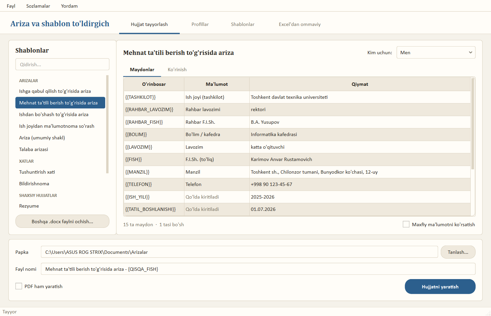
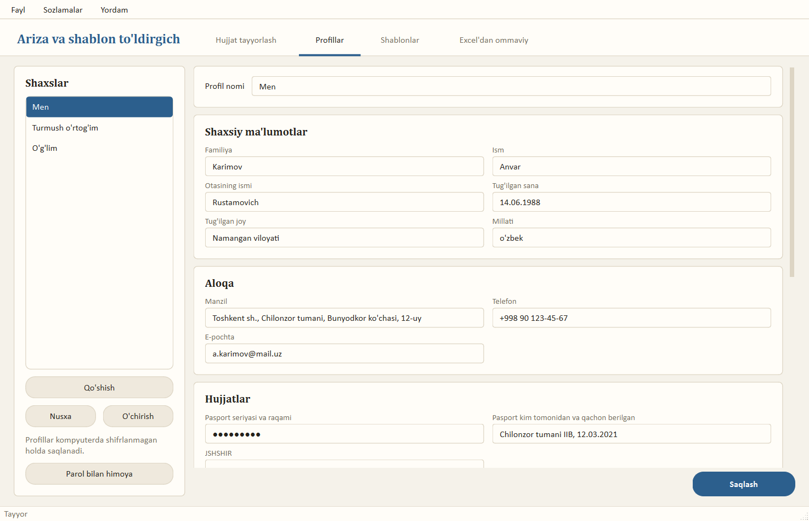
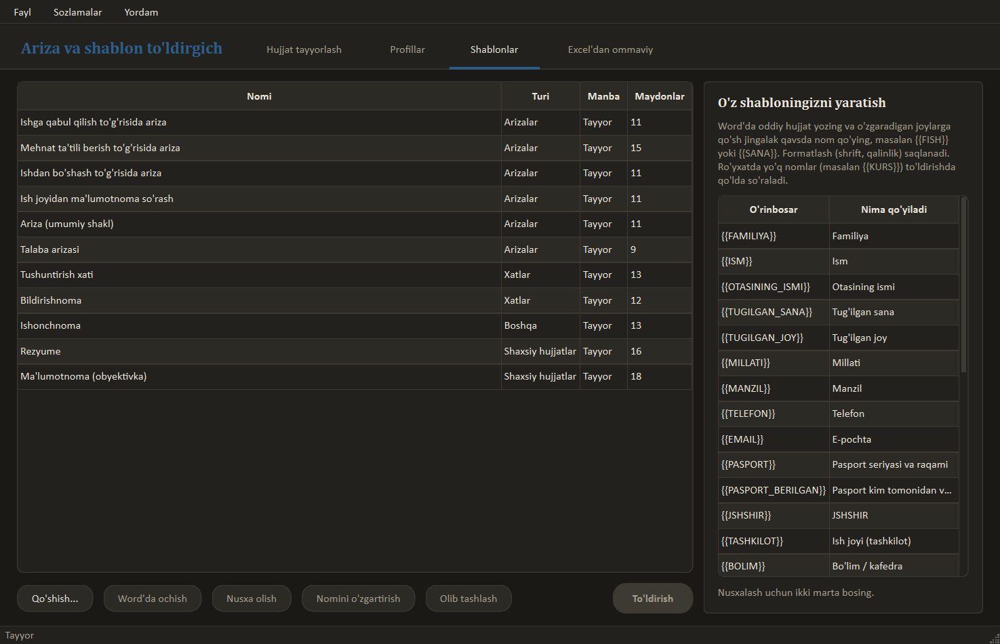
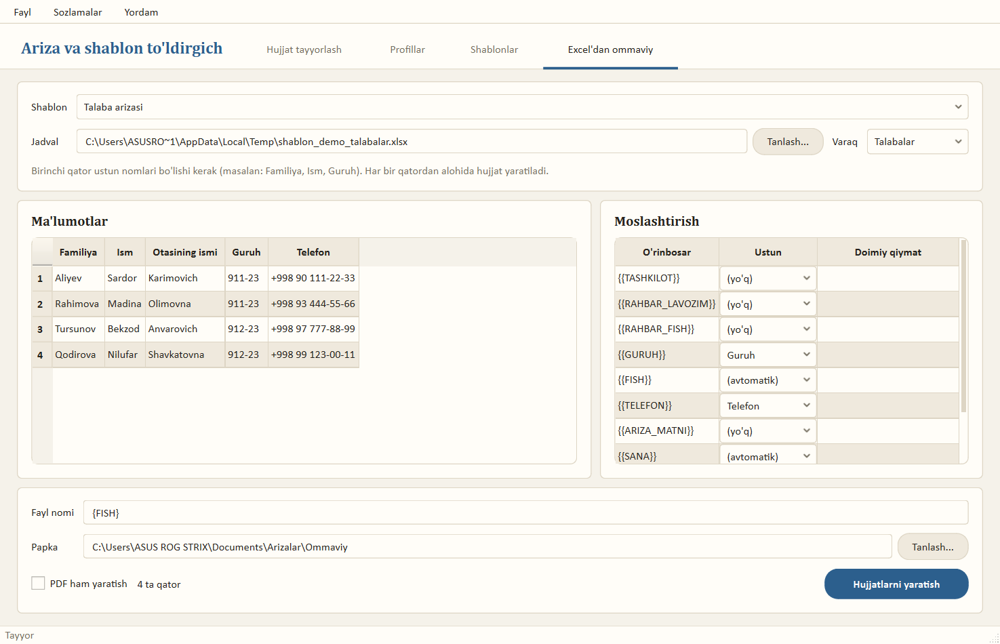

UDK: 004.42:004.91

# Word shablonlarini shaxsiy ma’lumotlar profillari asosida formatni saqlagan holda avtomatik to‘ldiruvchi oflayn dasturiy vosita: arxitektura va amalga oshirish

**Hakimov Bahtiyorjon**  
*[ish joyi, lavozimi, elektron pochta]*

**Annotatsiya.** Maqolada ariza, tushuntirish xati, ishonchnoma, rezyume va obyektivka kabi hujjatlarni Word (.docx) shablonlari asosida tayyorlashni avtomatlashtiruvchi “Ariza va shablon to‘ldirgich” dasturiy vositasi tavsiflanadi. Dastur Python 3.12 va PySide6 asosida yaratilgan, internetsiz ishlaydi. Unda shaxsiy ma’lumotlar profillari, profillarni parol bilan shifrlash (Fernet, kalit PBKDF2-SHA256 orqali), shablondagi qo‘sh jingalak qavsli o‘rinbosarlarni avtomatik aniqlash va profil maydonlariga moslash, Word bo‘laklarga ajratib yuborgan o‘rinbosarlarni ham formatni saqlab to‘ldirish, 11 ta tayyor o‘zbekcha shablon, Microsoft Word yoki LibreOffice orqali PDF yaratish hamda Excel va CSV jadvalidan ommaviy hujjat yaratish amalga oshirilgan. Ishonchlilik 21 ta avtomatik test bilan tekshirilgan.

*Kalit so‘zlar:* hujjat shabloni, Word avtomatlashtirish, Office Open XML, shaxsiy ma’lumotlar himoyasi, Fernet shifrlash, ommaviy hujjat yaratish, oflayn dastur.

**Офлайн-программное средство автоматического заполнения шаблонов Word на основе профилей персональных данных с сохранением форматирования: архитектура и реализация**

**Аннотация.** В статье описывается программное средство «Заполнение заявлений и шаблонов», автоматизирующее подготовку заявлений, объяснительных, доверенностей, резюме и объективок на основе шаблонов Word (.docx). Программа разработана на Python 3.12 и PySide6 и работает без интернета. Реализованы профили персональных данных, шифрование профилей паролем (Fernet, ключ через PBKDF2-SHA256), автоматическое обнаружение полей в двойных фигурных скобках и их сопоставление с данными профиля, заполнение с сохранением оформления даже при разбиении поля Word на несколько фрагментов, 11 готовых шаблонов на узбекском языке, создание PDF через Microsoft Word или LibreOffice и пакетная генерация документов из таблиц Excel и CSV. Надёжность проверена 21 автоматическим тестом.

*Ключевые слова:* шаблон документа, автоматизация Word, Office Open XML, защита персональных данных, шифрование Fernet, пакетное создание документов, офлайн-приложение.

**An offline software tool for format-preserving automatic filling of Word templates from personal data profiles: architecture and implementation**

**Abstract.** The paper describes the Template Filler, a software tool that automates the preparation of applications, explanatory notes, powers of attorney, CVs and personal record sheets from Word (.docx) templates. The program is written in Python 3.12 with PySide6 and works offline. It provides personal data profiles, optional password encryption of profiles (Fernet with a PBKDF2-SHA256 derived key), automatic detection of double-brace placeholders and their mapping to profile fields, format-preserving filling even when Word splits a placeholder into several runs, 11 ready-made Uzbek templates, PDF creation through Microsoft Word or LibreOffice, and batch generation of documents from Excel and CSV tables. Reliability is verified by 21 automated tests.

*Keywords:* document template, Word automation, Office Open XML, personal data protection, Fernet encryption, batch document generation, offline application.

## Kirish

Davlat va nodavlat tashkilotlarida, oliy ta’lim muassasalarida va kundalik hayotda fuqarolar muntazam ravishda bir xil turdagi hujjatlarni tayyorlaydi: ishga qabul qilish, mehnat ta’tili berish yoki ishdan bo‘shash to‘g‘risidagi arizalar, ish joyidan ma’lumotnoma so‘rash, tushuntirish xati, bildirishnoma, ishonchnoma, rezyume, ma’lumotnoma (obyektivka). Bu hujjatlarning shakli deyarli o‘zgarmaydi, o‘zgaradigan qismi esa shaxsiy ma’lumotlar (familiya, ism, otasining ismi, manzil, pasport ma’lumotlari, JSHSHIR, ish joyi, lavozim), rahbarning lavozimi va F.I.Sh.si hamda sana kabi bir necha elementdan iborat.

Amaliyotda bunday hujjatlar ko‘pincha avval tayyorlangan faylni nusxalab, undagi ma’lumotlarni qo‘lda almashtirish orqali tayyorlanadi. Bu yondashuvning kamchiliklari ma’lum: oldingi shaxsning ma’lumotlari hujjatda qolib ketishi, sana yangilanmay qolishi, bir hujjatda F.I.Sh.ning turli shakllari aralashib ketishi, formatlashning buzilishi. Oliy ta’lim muassasasi kafedrasida yoki kadrlar bo‘limida esa butun guruh talabalari yoki xodimlar uchun bir xil hujjatni o‘nlab nusxada tayyorlash zarurati tug‘iladi, bu ish qo‘lda bajarilganda ko‘p vaqt oladi va xato ehtimoli ortadi.

Hujjat aylanishini raqamlashtirish, jumladan “Raqamli O‘zbekiston – 2030” strategiyasida belgilangan davlat boshqaruvi va ta’lim tizimini raqamlashtirish vazifalari, takrorlanuvchi hujjatlarni avtomatik tayyorlash vositalariga ehtiyojni kuchaytiradi. Shu bilan birga, bunday hujjatlar shaxsiy ma’lumotlarni o‘z ichiga oladi, shuning uchun ularni tayyorlovchi vosita ma’lumotlarni tashqi serverga yubormasligi va kompyuterda himoyalangan holda saqlay olishi muhim.

Ushbu maqolada shu talablarga javob beruvchi “Ariza va shablon to‘ldirgich” dasturining vazifasi, arxitekturasi, Word hujjatini formatni buzmasdan to‘ldirish algoritmi, shaxsiy ma’lumotlarni himoyalash usuli va sinov natijalari bayon etiladi.

Dastur uchun shablon formati sifatida Word (.docx) tanlangani bejiz emas. Bu format ochiq standart (ECMA-376, Office Open XML) asosida qurilgan, tashkilotlarda eng keng tarqalgan va foydalanuvchiga tanish muharrirda shablonni mustaqil tayyorlash imkonini beradi. Shablon tayyorlash uchun maxsus dastur yoki dasturlash bilimi talab qilinmaydi: foydalanuvchi oddiy hujjat yozadi va o‘zgaradigan joylarga nom qo‘yadi. Natija ham .docx ko‘rinishida chiqqani uchun uni zarur bo‘lsa qo‘lda tahrirlash mumkin.

## Muammoning qo‘yilishi va mavjud yechimlar tahlili

Tadqiqot maqsadi – Word (.docx) shablonlarini foydalanuvchi bir marta kiritgan shaxsiy ma’lumotlar bilan formatlashni saqlagan holda avtomatik to‘ldiruvchi, ko‘p hujjatni jadval asosida ommaviy yaratuvchi va ma’lumotlarni faqat foydalanuvchi kompyuterida saqlovchi ish stoli ilovasini ishlab chiqish. Maqsadga erishish uchun quyidagi vazifalar qo‘yildi:

- bir nechta shaxs (foydalanuvchining o‘zi, oila a’zolari) uchun shaxsiy ma’lumotlar profillarini yuritish;
- profillarni ixtiyoriy parol bilan shifrlash va maxfiy maydonlarni (pasport, JSHSHIR) ekranda yashirish;
- shablondagi o‘rinbosarlarni avtomatik topish va ularni nomi bo‘yicha profil maydonlariga moslash, jumladan muqobil nomlar va kirill yozuvidagi nomlarni tanish;
- Word bitta o‘rinbosarni bir nechta matn bo‘lagiga (run) bo‘lib yuborgan holatda ham uni topish va o‘rniga qiymatni shu joydagi formatlash bilan qo‘yish;
- asosiy matndan tashqari jadvallar, kolontitullar, izohlar va matn bloklarini ham to‘ldirish;
- Excel yoki CSV jadvalining har bir qatori uchun alohida hujjat yaratish;
- kerak bo‘lsa natijani PDF formatiga o‘tkazish.
Mavjud yechimlarni umumiy turlarga ajratish mumkin. Birinchisi – matn muharrirlarining ommaviy pochta (mail merge) vositasi. U jadvaldan ko‘p hujjat yaratishga imkon beradi, biroq ma’lumot manbasi va maydonlarni har safar qo‘lda bog‘lashni talab qiladi, shaxsiy profil tushunchasi va shaxsiy ma’lumotlarni himoyalash vositalarini taklif etmaydi. Ikkinchisi – hujjat yaratishning onlayn xizmatlari va konstruktorlari. Ular qulay shakllar beradi, ammo internet aloqasini talab qiladi va shaxsiy ma’lumotlar tashqi serverda qayta ishlanadi. Uchinchisi – hujjat aylanishi tizimlarining ichki shablon modullari: ular tashkilot miqyosida ishlaydi, o‘rnatish va administratsiyani talab qiladi va alohida foydalanuvchi uchun ortiqcha murakkab.

Texnik nuqtai nazardan asosiy qiyinchilik Office Open XML formatining tuzilishi bilan bog‘liq. Word foydalanuvchi bitta so‘z sifatida ko‘rgan matnni imlo tekshiruvi, tahrirlash tarixi yoki formatlash o‘zgarishi sababli bir nechta “run” elementiga bo‘lib yuborishi mumkin. Natijada “{{FISH}}” o‘rinbosari XML ichida, masalan, “{{FI” va “SH}}” bo‘laklari ko‘rinishida saqlanadi va oddiy qidirish-almashtirish uni topa olmaydi. Shu sababli yechim paragraf darajasida ishlovchi algoritmni talab qiladi.

Bundan kelib chiqib, ishlab chiqiladigan vosita uchun quyidagi talablar shakllantirildi: o‘rnatishsiz bitta fayl ko‘rinishida tarqatilishi; internetsiz ishlashi; o‘zbek, rus va ingliz tilidagi interfeys; o‘zbek ish yuritish amaliyotiga mos tayyor shablonlar; shablon faylining hech qachon o‘zgartirilmasligi; mavjud faylning ustiga yozilmasligi.

## Tadqiqot metodologiyasi va dasturiy arxitektura

Dastur Python 3.12 tilida, grafik interfeys Qt 6 asosidagi PySide6 kutubxonasida yaratilgan. Word hujjatlarini o‘qish va yozish uchun python-docx (lxml bilan), Excel jadvallarini o‘qish uchun openpyxl, shifrlash uchun cryptography kutubxonasi, Microsoft Word orqali PDF yaratish uchun pywin32 ishlatiladi. Dastur PyInstaller yordamida bitta .exe faylga yig‘iladi. Uchinchi tomon komponentlari va ularning litsenziyalari loyihaning THIRD PARTY NOTICES hujjatida keltirilgan.

Kod vazifasiga ko‘ra quyidagi modullarga ajratilgan:

- **fields** – profil maydonlari ro‘yxati, ularning uch tildagi yorliqlari, muqobil nomlari, hisoblanadigan qiymatlar va o‘rinbosar nomini maydonga moslash;
- **docx fill** moduli – .docx fayldagi o‘rinbosarlarni topish, to‘ldirish, ko‘rinish uchun matn tayyorlash va fayl nomini shakllantirish;
- **store** – profillar omborini saqlash va ixtiyoriy shifrlash;
- **library** – tayyor va foydalanuvchi qo‘shgan shablonlar kutubxonasi;
- **batch** – Excel va CSV jadvallarini o‘qish, ustunlarni moslashtirish va ommaviy yaratish;
- **convert** – Microsoft Word yoki LibreOffice orqali PDF yaratish;
- **window** va **strings** – interfeys va uning uch tildagi matnlari;
- **uzkit** – menyu, mavzu, til, sozlamalar va fayl yo‘llari uchun umumiy karkas.
Profil modeli. Profil 23 ta maydondan iborat bo‘lib, ular beshta guruhga ajratilgan: “Shaxsiy ma’lumotlar” (familiya, ism, otasining ismi, tug‘ilgan sana va joy, millati), “Aloqa” (manzil, telefon, elektron pochta), “Hujjatlar” (pasport seriyasi va raqami, pasport kim tomonidan va qachon berilgani, JSHSHIR), “Ish va o‘qish” (tashkilot, bo‘lim yoki kafedra, lavozim, guruh, ma’lumoti, tamomlagan OTM, mutaxassisligi, ilmiy darajasi, chet tillari) va “Ariza kimga yoziladi (rahbar)” (rahbar lavozimi va F.I.Sh.). Pasport va JSHSHIR maxfiy maydon sifatida belgilangan: ular ekranda “AB*****67” ko‘rinishida niqoblanadi. Pasport raqami ikki harf va yetti raqam, JSHSHIR esa o‘n to‘rt raqamdan iboratligi tekshirilib, mos kelmasa ogohlantirish chiqariladi.

Hisoblanadigan qiymatlar. Profil maydonlaridan tashqari beshta qiymat avtomatik hisoblanadi: to‘liq F.I.Sh. (familiya, ism, otasining ismi), qisqa F.I.Sh. o‘zbek rasmiy uslubida (“B.M. Hakimov”), bugungi sana raqamli shaklda (kk.oo.yyyy), bugungi sana so‘z bilan (“2026-yil 27-noyabr”) va joriy yil.

O‘rinbosarlarni moslash. Shablondagi o‘rinbosar qo‘sh jingalak qavs ichidagi nom bilan belgilanadi, masalan, {{FISH}}, {{SANA}}, {{MANZIL}}, {{TELEFON}}, {{PASPORT}}, {{JSHSHIR}}, {{TASHKILOT}}, {{LAVOZIM}}. Nom normallashtiriladi: katta harfga o‘tkaziladi, apostroflar va harf yoki raqam bo‘lmagan belgilar olib tashlanadi. Har bir maydon uchun muqobil nomlar ro‘yxati mavjud (masalan, tashkilot uchun “ISHJOYI”, “MUASSASA”, “WORKPLACE”, “МЕСТОРАБОТЫ”), kirill yozuvidagi nomlar esa lotinga transliteratsiya qilinib solishtiriladi. Mos maydon topilmagan o‘rinbosar “Qo‘lda kiritiladi” deb belgilanadi va qiymati foydalanuvchidan so‘raladi; kiritilgan qiymat keyingi safar uchun eslab qolinadi.

To‘ldirish algoritmi. Har bir paragrafdagi barcha matn elementlari birlashtirilib, umumiy satr bo‘yicha o‘rinbosarlar qidiriladi. Topilgan o‘rinbosarning boshlanish va tugash nuqtalari dastlabki elementlarga qaytarib hisoblanadi, qiymat o‘rinbosar boshlangan elementga yoziladi va shu tariqa u yerdagi shrift, qalinlik va boshqa formatlashni oladi; qolgan bo‘laklardan o‘rinbosar qoldiqlari olib tashlanadi. Ko‘p qatorli qiymatlar qator uzilishi elementlari bilan qo‘yiladi. Qayta ishlash hujjatning asosiy qismi, ichma-ich jadvallar, sarlavha va pastki kolontitullar, izohlar hamda matn bloklarini qamrab oladi. Qiymatlardan XML uchun yaroqsiz boshqaruv belgilari tozalanadi.

Xavfsizlik choralari. Profillar %APPDATA%\BahtiyorSoft\shablon-toldirgich papkasidagi profiles.json faylida saqlanadi. Parol qo‘yilgan bo‘lsa, ma’lumotlar Fernet (AES asosidagi autentifikatsiyalangan shifrlash) bilan shifrlanadi, kalit esa paroldan tasodifiy “tuz” va 390 000 iteratsiyali PBKDF2-HMAC-SHA256 funksiyasi orqali olinadi. Noto‘g‘ri parol shifrni ochishda autentifikatsiya xatosiga olib keladi va ma’lumotlar ko‘rsatilmaydi. Parol unutilsa, ma’lumotlarni tiklash imkoni yo‘q, bu haqda foydalanuvchi oldindan ogohlantiriladi. Shablon fayli hech qachon o‘zgartirilmaydi: natija vaqtinchalik faylga yozilib, so‘ng yakuniy nomga o‘tkaziladi, kirish va chiqish fayli bir xil bo‘lsa amal rad etiladi, mavjud fayl bo‘lsa nomiga “(2)”, “(3)” qo‘shiladi. Dastur internetga murojaat qilmaydi.

Interfeys darajasida ham himoya choralari ko‘rilgan. Maxfiy maydonlarning to‘liq qiymati faqat “Maxfiy ma’lumotni ko‘rsatish” bayrog‘i yoqilganda ko‘rinadi va tahrirlanadi, aks holda jadvalda niqoblangan ko‘rinish chiqadi. Qo‘lda kiritilgan qiymatlarni eslab qolish faqat qulaylik uchun mo‘ljallangan va sozlamalar faylida saqlanadi. Kutilmagan xatolik yuz berganda tafsilotlar jurnal fayliga yoziladi, foydalanuvchiga esa tushunarli xabar ko‘rsatiladi.

Ma’lumot oqimi quyidagicha: foydalanuvchi shablon va profilni tanlaydi; shablondan o‘rinbosarlar ro‘yxati olinadi; har biri maydonga moslanadi; profil va hisoblanadigan qiymatlardan jadval to‘ldiriladi; foydalanuvchi bo‘sh qatorlarni to‘ldiradi va ko‘rinishni tekshiradi; hujjat yangi faylga yoziladi va kerak bo‘lsa PDF ga o‘tkaziladi.

Shablonlar kutubxonasi ikki manbadan shakllanadi. Tayyor shablonlar dastur ichidagi resurs papkasida, ularning nomlari uch tilda va toifalari esa alohida indeks faylida saqlanadi. Foydalanuvchi qo‘shgan shablonlar profil papkasidagi templates katalogiga nusxalanadi va o‘z indeksiga ega bo‘ladi. Tayyor shablonni to‘g‘ridan to‘g‘ri o‘zgartirib bo‘lmaydi, ammo undan nusxa olib, nusxani tahrirlash mumkin. Bu yechim dastur yangilanganda tayyor shablonlarni almashtirish va foydalanuvchi o‘zgarishlarini saqlab qolish imkonini beradi.

Ommaviy rejimda har bir o‘rinbosar qiymati quyidagi ustuvorlik bo‘yicha aniqlanadi: avval moslashtirilgan ustundagi qiymat, u bo‘sh bo‘lsa – qatordagi familiya, ism va otasining ismi ustunlaridan hisoblangan qiymat (to‘liq yoki qisqa F.I.Sh., sana, yil), u ham bo‘lmasa – “Doimiy qiymat” ustunidagi qiymat. Har bir hujjatning fayl nomi namunadan qator qiymatlari bilan hosil qilinadi, takroriy nomlar raqam qo‘shish orqali ajratiladi. Jadvalning bo‘sh qatorlari e’tiborga olinmaydi.

## Amalga oshirish va asosiy funksiyalar

Dastur oynasi to‘rt bo‘limdan iborat: “Hujjat tayyorlash”, “Profillar”, “Shablonlar” va “Excel’dan ommaviy”.

“Hujjat tayyorlash” bo‘limida (1-rasm) chapda toifalarga ajratilgan shablonlar ro‘yxati va qidirish maydoni, pastda “Boshqa .docx faylni ochish...” tugmasi joylashgan. O‘ng qismda tanlangan shablon nomi, “Kim uchun:” profil tanlovi va ikki varaq bor: “Maydonlar” varag‘idagi jadvalda “O‘rinbosar”, “Ma’lumot” va “Qiymat” ustunlari ko‘rsatiladi, “Ko‘rinish” varag‘ida esa to‘ldirilgan hujjat matni oldindan ko‘riladi. Jadval ostida maydonlar soni va bo‘sh qolganlari soni chiqadi. Pastki panelda saqlash papkasi, fayl nomi namunasi, “PDF ham yaratish” bayrog‘i va “Hujjatni yaratish” tugmasi joylashgan. Fayl nomi namunasida bitta jingalak qavsdagi nomlar, masalan {FISH} yoki {SANA}, qiymat bilan almashtiriladi, Windows fayl nomlarida taqiqlangan belgilar olib tashlanadi. Bo‘sh maydon qolganda hujjat yaratishdan oldin tasdiq so‘raladi.

“Profillar” bo‘limida (2-rasm) chapda “Shaxslar” ro‘yxati, “Qo‘shish”, “Nusxa”, “O‘chirish” tugmalari, saqlash holati haqidagi yozuv va “Parol bilan himoya” tugmasi bor. O‘ng qismda profil nomi va beshta guruhdagi maydonlar joylashgan. Parol qo‘yish, o‘zgartirish va olib tashlash shu bo‘limdan bajariladi; shifrlangan profillar keyingi ishga tushirishda parol kiritilgunga qadar qulflangan bo‘ladi.

“Shablonlar” bo‘limida (3-rasm) kutubxonadagi barcha shablonlar nomi, turi (“Arizalar”, “Xatlar”, “Shaxsiy hujjatlar”, “Boshqa”), manbasi (“Tayyor” yoki foydalanuvchiniki) va maydonlar soni bilan ko‘rsatiladi. Dastur bilan 11 ta tayyor shablon keladi: ishga qabul qilish, mehnat ta’tili berish va ishdan bo‘shash to‘g‘risidagi arizalar, ish joyidan ma’lumotnoma so‘rash, umumiy shakldagi ariza, talaba arizasi, tushuntirish xati, bildirishnoma, ishonchnoma, rezyume va ma’lumotnoma (obyektivka). “Qo‘shish...”, “Word’da ochish”, “Nusxa olish”, “Nomini o‘zgartirish”, “Olib tashlash” va “To‘ldirish” tugmalari mavjud. Foydalanuvchi qo‘shgan fayl kutubxonaga nusxalanadi, asl fayl joyida qoladi. O‘ng paneldagi “O‘z shabloningizni yaratish” qismida o‘rinbosar nomlari va ularga nima qo‘yilishi jadvali beriladi, nomni ikki marta bosib nusxalash mumkin.

“Excel’dan ommaviy” bo‘limida (4-rasm) shablon, jadval fayli (Excel .xlsx yoki CSV) va Excel varag‘i tanlanadi. Jadvalning birinchi qatori ustun nomlari sifatida o‘qiladi. CSV fayllar avval UTF-8, so‘ng Windows-1251 kodlashida o‘qiladi, ajratgich (vergul, nuqtali vergul yoki tabulyatsiya) avtomatik aniqlanadi. “Moslashtirish” jadvalida har bir o‘rinbosar uchun ustun avtomatik tanlanadi: avval aynan bir xil nom, keyin normallashtirilgan nom, so‘ng maydon kaliti bo‘yicha. Familiya, ism va otasining ismi ustunlari mavjud bo‘lsa, to‘liq va qisqa F.I.Sh. har bir qator uchun avtomatik hisoblanadi. Barcha qatorlar uchun bir xil qiymat “Doimiy qiymat” ustuniga yoziladi. “Hujjatlarni yaratish” tugmasi har bir qator uchun alohida .docx (va xohishga ko‘ra PDF) yaratadi.

PDF yaratish. Agar kompyuterda Microsoft Word o‘rnatilgan bo‘lsa, u ko‘rinmas rejimda ishga tushirilib, barcha hujjatlar bitta Word nusxasi orqali PDF ga o‘tkaziladi. Word bo‘lmasa, LibreOffice dasturi ishlatiladi. Ikkalasi ham bo‘lmasa, .docx fayl yaratiladi va foydalanuvchiga tegishli xabar beriladi.

Odatiy ish ssenariysi quyidagicha. Foydalanuvchi bir marta o‘z profilini to‘ldiradi. Ta’tilga chiqish arizasi kerak bo‘lganda, u “Hujjat tayyorlash” bo‘limida tegishli shablonni tanlaydi; tashkilot, bo‘lim, lavozim, rahbar lavozimi va F.I.Sh.si, manzil va telefon profildan qo‘yiladi, sana avtomatik hisoblanadi. Foydalanuvchi faqat ish yili va ta’til boshlanish sanasi kabi profilda bo‘lmagan qiymatlarni kiritadi, “Ko‘rinish” varag‘ida matnni tekshiradi va hujjatni yaratadi. Qo‘lda kiritilgan qiymatlar keyingi safar uchun eslab qolinadi, shuning uchun takroriy hujjatda ularni qayta yozish shart emas.

*1-rasm. “Hujjat tayyorlash” bo‘limi: chapda shablonlar ro‘yxati, o‘ngda “Mehnat ta’tili berish to‘g‘risida ariza” shablonining o‘rinbosarlari, ularga mos profil maydonlari va qiymatlari, pastda papka, fayl nomi va “Hujjatni yaratish” tugmasi*

*2-rasm. “Profillar” bo‘limi: “Shaxslar” ro‘yxati, “Shaxsiy ma’lumotlar”, “Aloqa” va “Hujjatlar” guruhlari; pasport raqami yashirin ko‘rinishda*

*3-rasm. “Shablonlar” bo‘limi (qorong‘i mavzu): 11 ta tayyor shablon turi va maydonlar soni bilan, o‘ngda “O‘z shabloningizni yaratish” bo‘yicha o‘rinbosarlar jadvali*

*4-rasm. “Excel’dan ommaviy” bo‘limi: “Talaba arizasi” shabloni, to‘rt qatorli jadval va o‘rinbosarlarni ustunlarga moslashtirish jadvali*

## Sinov va natijalar

Dasturning to‘g‘riligi pytest asosidagi 21 ta avtomatik test funksiyasi bilan tekshiriladi (ularning ayrimlari bir nechta kirish qiymati bilan parametrlangan).

- **Mantiq testlari (13 ta).** Bo‘laklarga ajratilgan o‘rinbosarlarni topish; asosiy matn, jadval va kolontitullarni formatni saqlab to‘ldirish; topilmagan o‘rinbosarlarni saqlab qolish rejimi; kirish va chiqish fayli bir xil bo‘lishidan himoya; o‘rinbosar nomlarini maydonlarga moslash; hisoblanadigan qiymatlar; niqoblash va tekshiruv qoidalari; ochiq va shifrlangan profil omborini saqlash-yuklash; barcha tayyor shablonlarni o‘qish va to‘ldirish; Excel va CSV jadvalidan ommaviy yaratish; fayl nomi namunasini qayta ishlash; shablonlar kutubxonasi amallari.
- **Chuqur testlar (5 ta).** XML uchun yaroqsiz belgilar bo‘lgan qiymatlarning hujjatni buzmasligi; bitta ustunli va Windows-1251 kodlashidagi CSV fayl; qator uzilishlari va takroriy nomlar bo‘lgan Excel jadvalidan ommaviy yaratish; shablon faylining o‘zgarmay qolishi; buzilgan .docx fayl haqida xato xabari.
- **Tutun testlari (3 ta).** Asosiy oynaning yaratilishi, uch tildagi tarjimalarning to‘liqligi va hujjat tayyorlash sahifasidagi asosiy ish oqimi.
Funksional ko‘rsatkichlar: 23 ta profil maydoni va 5 ta hisoblanadigan qiymat; 11 ta tayyor shablon; kirish formatlari – .docx shablonlar, Excel (.xlsx) va CSV jadvallar; chiqish formatlari – .docx va PDF; interfeys tillari – o‘zbek, rus va ingliz. Dastur Windows 10 (1809 va undan keyingi) va Windows 11 x64 tizimlarida o‘rnatishsiz ishlaydi.

Ish tezligi, foydalanuvchilar soni yoki foydalanuvchilar fikri bo‘yicha o‘lchovlar o‘tkazilmagan, shuning uchun bunday ko‘rsatkichlar keltirilmaydi. Sinov natijalari funksional to‘g‘rilik va xatolarga chidamlilik bilan cheklanadi.

Testlarda haqiqiy .docx va .xlsx fayllar vaqtinchalik papkada yaratiladi, dastur ularni to‘ldirgandan so‘ng natija python-docx yordamida qayta o‘qilib, kutilgan matn va formatlash bilan solishtiriladi. Shu tariqa algoritm faqat ichki ma’lumot tuzilmalari darajasida emas, balki yakuniy fayl darajasida tekshiriladi. Interfeys testlari Qt oynasini ekranga chiqarmasdan yaratadi.

## Muhokama

Dasturning asosiy afzalliklari quyidagilardan iborat. Birinchidan, shaxsiy ma’lumotlar bir marta kiritiladi va barcha shablonlarda qayta ishlatiladi, bu esa bir hujjatda ma’lumotlarning nomuvofiqligi xavfini kamaytiradi. Ikkinchidan, to‘ldirish paragraf darajasida bajarilgani uchun Word o‘rinbosarni qanday bo‘laklarga bo‘lganidan qat’i nazar natija bir xil bo‘ladi va formatlash saqlanadi. Uchinchidan, o‘rinbosar nomlarini moslashda muqobil nomlar va transliteratsiyadan foydalanish uchinchi shaxslar tayyorlagan shablonlar bilan ham ishlash imkonini beradi. To‘rtinchidan, shaxsiy ma’lumotlar kompyuterdan tashqariga chiqmaydi va parol bilan shifrlanishi mumkin. Beshinchidan, ommaviy rejim kafedra va kadrlar bo‘limi uchun bir xil hujjatlarni o‘nlab nusxada tayyorlashni bitta amalga aylantiradi.

Cheklovlar ham mavjud. Dastur faqat .docx formatidagi shablonlar bilan ishlaydi, eski .doc formatini qo‘llab-quvvatlamaydi. Qiymat o‘rinbosar boshlangan joydagi formatni oladi, ya’ni o‘rinbosar ichida formatlash o‘zgargan bo‘lsa, qiymatning faqat bitta formati saqlanadi. PDF yaratish uchun kompyuterda Microsoft Word yoki LibreOffice o‘rnatilgan bo‘lishi kerak. Shartli bloklar (masalan, qiymat bo‘sh bo‘lsa paragrafni olib tashlash) va jadval qatorlarini takrorlash kabi murakkab shablon mantiqiy konstruksiyalari amalga oshirilmagan. Shifrlash faqat profillar omboriga tatbiq etiladi; yaratilgan hujjatlar oddiy fayl sifatida saqlanadi va ularni himoyalash foydalanuvchi zimmasida.

Rivojlantirish istiqbollari sifatida shartli bloklar va takrorlanuvchi jadval qatorlarini qo‘llab-quvvatlash, tayyor shablonlar to‘plamini kengaytirish (masalan, ta’lim muassasalari uchun qo‘shimcha ariza shakllari), yaratilgan hujjatlarni ixtiyoriy shifrlash va profil ma’lumotlarini jadvaldan import qilish imkoniyatlarini ko‘rsatish mumkin.

O‘quv jarayoni nuqtai nazaridan dastur ish yuritish va ofis texnologiyalari fanlarida ko‘rgazmali vosita bo‘la oladi. U shablon, o‘rinbosar va ma’lumot manbasi tushunchalarini amalda ko‘rsatadi, ommaviy pochta texnologiyasining mohiyatini tushuntiradi, shuningdek shaxsiy ma’lumotlarni himoyalash, parol va shifrlash masalalarini real misolda muhokama qilish imkonini beradi.

## Xulosa

Ishda Word shablonlarini shaxsiy ma’lumotlar profillari asosida avtomatik to‘ldiruvchi oflayn dasturiy vosita taqdim etildi. Paragraf darajasida ishlovchi to‘ldirish algoritmi bo‘laklarga ajratilgan o‘rinbosarlarni ham topib, formatni saqlab qo‘yish imkonini beradi va asosiy matn, jadvallar, kolontitullar, izohlar hamda matn bloklarini qamrab oladi. O‘rinbosar nomlarini normallashtirish, muqobil nomlar va transliteratsiya orqali moslash shablon tayyorlash talablarini yengillashtiradi. Profillarni Fernet va PBKDF2-HMAC-SHA256 asosida shifrlash shaxsiy ma’lumotlarni himoyalaydi. Excel va CSV jadvallaridan ommaviy yaratish hamda Word yoki LibreOffice orqali PDF tayyorlash funksiyalari vositani tashkilotlarda qo‘llash imkoniyatini kengaytiradi.

Dastur 11 ta tayyor o‘zbekcha shablon bilan tarqatiladi, uning funksional to‘g‘riligi 21 ta avtomatik test bilan tasdiqlangan. Vosita fuqarolar, talabalar, o‘qituvchilar, kadrlar bo‘limi va devonxona xodimlari uchun takrorlanuvchi hujjatlarni tayyorlash vaqtini qisqartirishga va hujjatlardagi ma’lumotlarning bir xilligini ta’minlashga xizmat qiladi.

Taqdim etilgan yondashuv – ma’lumotni hujjat shaklidan ajratish, uni bir marta tuzilgan ko‘rinishda saqlash va shablonlar orqali ko‘p marta qayta ishlatish – ish yuritishning boshqa sohalarida ham qo‘llanishi mumkin. Dasturning modulli tuzilishi yangi tayyor shablonlar, yangi profil maydonlari va qo‘shimcha chiqish formatlarini mavjud kodga katta o‘zgartirish kiritmasdan qo‘shish imkonini beradi.

## Foydalanilgan adabiyotlar

1. Python Software Foundation. Python 3.12 Documentation [Elektron resurs]. – URL: https://docs.python.org/3.12/ (murojaat sanasi: 27.11.2026).
2. The Qt Company. Qt for Python (PySide6) Documentation [Elektron resurs]. – URL: https://doc.qt.io/qtforpython-6/ (murojaat sanasi: 27.11.2026).
3. python-docx Documentation [Elektron resurs]. – URL: https://python-docx.readthedocs.io/en/latest/ (murojaat sanasi: 27.11.2026).
4. openpyxl Documentation [Elektron resurs]. – URL: https://openpyxl.readthedocs.io/en/stable/ (murojaat sanasi: 27.11.2026).
5. Python Cryptographic Authority. cryptography Documentation [Elektron resurs]. – URL: https://cryptography.io/en/latest/ (murojaat sanasi: 27.11.2026).
6. PyInstaller Development Team. PyInstaller Manual [Elektron resurs]. – URL: https://pyinstaller.org/en/stable/ (murojaat sanasi: 27.11.2026).
7. ECMA-376. Office Open XML File Formats [Elektron resurs]. – Geneva : Ecma International. – URL: https://ecma-international.org/publications-and-standards/standards/ecma-376/ (murojaat sanasi: 27.11.2026).
8. Moriarty K., Kaliski B., Rusch A. RFC 8018. PKCS #5: Password-Based Cryptography Specification Version 2.1 [Elektron resurs]. – IETF, 2017. – URL: https://www.rfc-editor.org/rfc/rfc8018 (murojaat sanasi: 27.11.2026).
9. O‘zbekiston Respublikasi Prezidentining 2020-yil 5-oktabrdagi PF-6079-son “Raqamli O‘zbekiston – 2030” strategiyasini tasdiqlash va uni samarali amalga oshirish chora-tadbirlari to‘g‘risida”gi Farmoni.
10. Hakimov B. shablon-toldirgich: dastur manba kodi va relizlari [Elektron resurs]. – URL: https://github.com/eduhakimov/shablon-toldirgich (murojaat sanasi: 27.11.2026).
