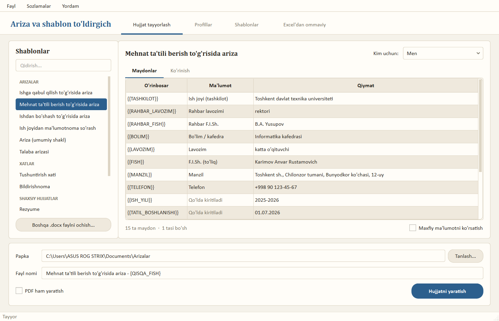
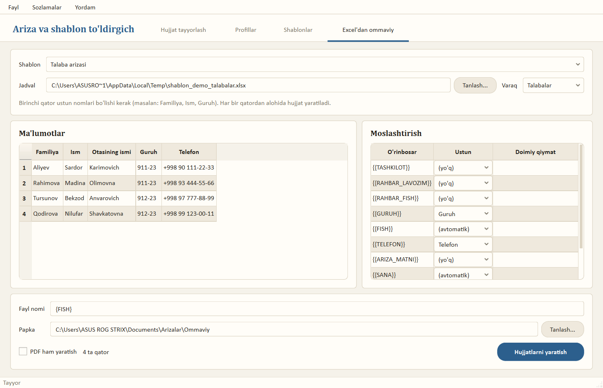
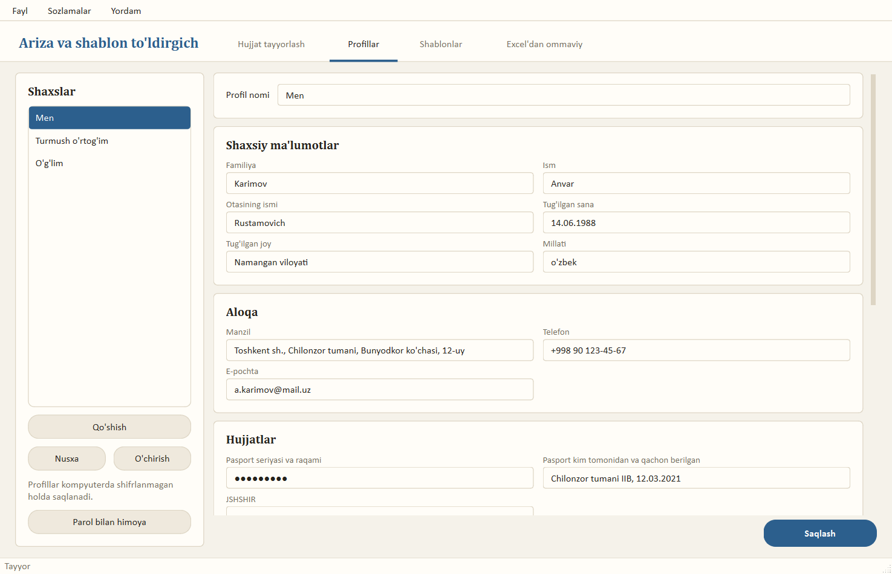

# Ariza va shablon to‘ldirgich: Uslubiy ko‘rsatma

Muallif: Hakimov Bahtiyorjon. Versiya: 1.0.2.

## 1. Uslubiy ko‘rsatmaning maqsadi va vazifalari

Ushbu uslubiy ko‘rsatma “Ariza va shablon to‘ldirgich” dasturidan oliy ta’lim muassasalari, kollej va texnikumlarda o‘quv mashg‘ulotlarida, shuningdek tashkilotlarning kadrlar bo‘limi, devonxona va dekanat faoliyatida foydalanish tartibini belgilaydi.

Maqsad – o‘quvchi va xodimlarda rasmiy hujjatlarni shablon asosida tayyorlash, ish yuritish hujjatlarining tuzilishini tushunish, takrorlanuvchi ishlarni avtomatlashtirish va shaxsiy ma’lumotlarni xavfsiz qayta ishlash ko‘nikmalarini shakllantirish.

Vazifalar:

- ariza, tushuntirish xati, bildirishnoma, ishonchnoma va obyektivkaning rekvizitlari va tuzilishi bilan tanishtirish;
- shablon tushunchasini, o‘zgarmas va o‘zgaruvchan qismlarni ajratishni o‘rgatish;
- Word hujjatida o‘rinbosarlar bilan o‘z shablonini yaratishni mashq qildirish;
- jadvaldagi ma’lumotlar asosida ommaviy hujjat yaratish texnologiyasini ko‘rsatish;
- shaxsiy ma’lumotlarni himoyalash, parol va shifrlash tushunchalarini amaliy misolda tushuntirish.
Ko‘rsatma o‘qituvchiga mashg‘ulot rejasini, amaliy topshiriqlar to‘plamini, baholash mezonlari va nazorat savollarini taqdim etadi. Mashg‘ulot yakunida talaba nafaqat dastur yordamida hujjat tayyorlay oladi, balki shablonning tuzilishini, o‘rinbosarlarning vazifasini va ma’lumotlarni himoyalash zarurligini tushuntira oladi. Ko‘rsatmani fan dasturi va guruh tayyorgarligiga qarab qisqartirish yoki kengaytirish mumkin.

## 2. Qo‘llash sohasi va maqsadli auditoriya

Dasturdan quyidagi fanlar va mashg‘ulotlarda foydalanish tavsiya etiladi:

- “Ish yuritish”, “Hujjatshunoslik”, “Kotiblik ishi”, “Davlat tilida ish yuritish” fanlari;
- “Informatika va axborot texnologiyalari”, “Ofis dasturlari” fanlarida matnli hujjatlarni avtomatlashtirish mavzusi;
- “Axborot xavfsizligi asoslari” fanida shaxsiy ma’lumotlarni himoyalash va shifrlash mavzusi;
- “Kadrlar boshqaruvi”, “Menejment” yo‘nalishlarida kadrlar hujjatlari bilan ishlash;
- kollej va texnikumlarda kotib, ofis menejeri, kompyuter operatori mutaxassisliklari bo‘yicha amaliyot.
Maqsadli auditoriya: bakalavriat talabalari, kollej va texnikum o‘quvchilari, fan o‘qituvchilari, shuningdek tashkilotlarning kadrlar bo‘limi, devonxona, dekanat va kafedra xodimlari.

Kasbiy faoliyatda dastur dekanatda talabalar arizalarini guruh ro‘yxati asosida tayyorlash, kafedrada xodimlar uchun bir xil xatlar va ma’lumotnomalar tayyorlash, kadrlar bo‘limida ta’til va ishga qabul arizalarini tayyorlashda qo‘llanishi mumkin.

Fanlararo bog‘liqlik nuqtai nazaridan dastur ish yuritish (hujjat mazmuni va rekvizitlari), informatika (fayl formatlari va avtomatlashtirish) va axborot xavfsizligi (shaxsiy ma’lumotlar himoyasi) fanlarini bitta amaliy topshiriqda birlashtirish imkonini beradi. Shu sababli undan integrallashgan mashg‘ulotlar va kurs ishlarida ham foydalanish mumkin.

Dastur o‘zbek, rus va ingliz tilidagi interfeysga ega bo‘lgani uchun uni turli ta’lim tillaridagi guruhlarda qo‘llash mumkin. Tayyor shablonlar o‘zbek tilida tuzilgan, rus yoki ingliz tilidagi hujjatlar uchun esa talabalar o‘z shablonlarini yaratadi, bu ham qo‘shimcha amaliy mashq bo‘lib xizmat qiladi.

## 3. O‘quv mashg‘ulotida foydalanish tartibi

Quyida 80 daqiqalik amaliy mashg‘ulot rejasi keltirilgan. Mashg‘ulot kompyuter sinfida o‘tkaziladi, har bir kompyuterda dastur va Microsoft Word (yoki .docx ni ochadigan boshqa muharrir) bo‘lishi kerak. Internet talab qilinmaydi.

**Muhim tayyorgarlik:** mashg‘ulotda haqiqiy shaxsiy ma’lumotlar (haqiqiy pasport raqami, JSHSHIR) ishlatilmaydi. O‘qituvchi oldindan o‘ylab topilgan shartli ma’lumotlar to‘plamini va 10–15 qatorli namunaviy Excel jadvalini tayyorlaydi.

**Tashkiliy qism (5 daqiqa).** Davomat, mashg‘ulot mavzusi va maqsadini e’lon qilish: talaba mashg‘ulot oxirida tayyor shablon bo‘yicha ariza, o‘zi yaratgan shablon va jadval asosidagi hujjatlar to‘plamini tayyorlaydi.

**Nazariy qism (20 daqiqa).** Ariza va xatlarning rekvizitlari (kimga, kimdan, hujjat nomi, matn, sana, imzo); shablon tushunchasi; o‘rinbosar va uning nomi; Word hujjati ichida matnning bo‘laklarga bo‘linishi sababli oddiy qidirish-almashtirish ishonchsizligi; ommaviy pochta (mail merge) g‘oyasi; shaxsiy ma’lumotlarni himoyalash, parol va shifrlash tushunchalari.

Nazariy qism davomida o‘qituvchi proyektorda dasturning to‘rtta bo‘limini qisqacha namoyish qiladi va bitta tayyor arizani to‘ldirib ko‘rsatadi. Shuningdek, bir xil shablon asosida ikki xil shaxs uchun tayyorlangan hujjatlarni solishtirib, qaysi qismlar o‘zgarmas va qaysilari o‘zgaruvchan ekanini talabalar bilan birga aniqlaydi.

**Amaliy qism (45 daqiqa).**

1. Shartli ma’lumotlar bilan profil yaratish, maxfiy maydonlarning yashirilishini kuzatish (8 daqiqa).
2. Tayyor shablon (“Mehnat ta’tili berish to‘g‘risida ariza”) bo‘yicha hujjat tayyorlash, qo‘lda kiritiladigan maydonlarni to‘ldirish va “Ko‘rinish” varag‘ida tekshirish (10 daqiqa).
3. Word’da o‘z shablonini yaratish (masalan, “Dars qoldirish sababi haqida tushuntirish xati”), kutubxonaga qo‘shish va to‘ldirish (12 daqiqa).
Amaliy qism davomida o‘qituvchi sinf bo‘ylab yurib, talabalar duch kelgan muammolarni (o‘rinbosar bitta qavs bilan yozilgani, ustun nomi birinchi qatorda emasligi, fayl Word’da ochiq qolgani) individual hal qiladi va eng ko‘p uchragan xatolarni yakuniy qism uchun qayd etadi.

4. Namunaviy Excel jadvali asosida guruh uchun ommaviy hujjat yaratish (10 daqiqa).
5. Profillarga parol qo‘yish va dasturni qayta ochib, qulflanishni tekshirish (5 daqiqa).
**Yakuniy qism (10 daqiqa).** Natijalarni ko‘rib chiqish, tipik xatolarni (noto‘g‘ri yozilgan o‘rinbosar, moslanmagan ustun, bo‘sh qolgan maydon) muhokama qilish, mustaqil ish topshirig‘ini berish. Mashg‘ulot oxirida shartli profillar o‘chiriladi.

Mashg‘ulot natijasida har bir talabaning papkasida quyidagi fayllar bo‘lishi kutiladi: tayyor shablon bo‘yicha bitta ariza (.docx, imkon bo‘lsa .pdf), o‘zi yaratgan shablon fayli va u asosida to‘ldirilgan hujjat, ommaviy yaratish natijasidagi hujjatlar to‘plami. O‘qituvchi ushbu fayllarni yakuniy qismda tanlab ko‘rib chiqadi.

*1-rasm. “Hujjat tayyorlash” bo‘limi: chapda shablonlar ro‘yxati, o‘ngda “Mehnat ta’tili berish to‘g‘risida ariza” shablonining o‘rinbosarlari, ularga mos profil maydonlari va qiymatlari, pastda papka, fayl nomi va “Hujjatni yaratish” tugmasi*

## 4. Amaliy topshiriqlar

**1-topshiriq. Profil va oila a’zolari.** Shartli ma’lumotlar bilan “Men” profilini yarating, so‘ng “Nusxa” orqali “Ukam” profilini tayyorlab, farqli maydonlarni o‘zgartiring. Kutilgan natija: ikkala profil “Shaxslar” ro‘yxatida, umumiy manzil va telefon ikkalasida ham bir xil.

**2-topshiriq. Tayyor ariza.** “Ishdan bo‘shash to‘g‘risida ariza” shablonini “Men” profili uchun to‘ldiring, fayl nomi namunasiga {FISH} ni qo‘shing va .docx yarating. Kutilgan natija: fayl nomida to‘liq F.I.Sh. bor, hujjatda sana va rahbar ma’lumotlari to‘g‘ri joyda.

**3-topshiriq. Qo‘lda kiritiladigan maydonlar.** “Mehnat ta’tili berish to‘g‘risida ariza” shablonida “Qo‘lda kiritiladi” deb belgilangan qatorlarni aniqlang va to‘ldiring. Kutilgan natija: talaba qaysi o‘rinbosarlar profildan, qaysilari qo‘lda to‘ldirilishini tushuntiradi va maydonlar soni ostida bo‘sh maydon qolmaydi.

**4-topshiriq. O‘z shabloningiz.** Word’da {{FISH}}, {{GURUH}}, {{SANA}} va ro‘yxatda yo‘q {{SABAB}} o‘rinbosarlari bilan tushuntirish xati shablonini yarating, bir joyda o‘rinbosarni qalin shriftda yozing. Kutilgan natija: dastur barcha o‘rinbosarlarni topadi, {{SABAB}} qo‘lda so‘raladi, qalin formatlash natijada saqlanadi.

**5-topshiriq. Ommaviy yaratish.** “Familiya”, “Ism”, “Otasining ismi”, “Guruh” ustunlari bo‘lgan 10 qatorli jadval asosida “Talaba arizasi” bo‘yicha hujjatlarni yarating, tashkilot nomini “Doimiy qiymat” ga yozing. Kutilgan natija: 10 ta alohida .docx fayl, har birining nomida talabaning F.I.Sh.si.

**6-topshiriq. CSV va kodlash.** Xuddi shu jadvalni CSV formatida saqlab, ommaviy yaratishni takrorlang. Kutilgan natija: talaba ajratgich va kodlash avtomatik aniqlanishini kuzatadi, o‘zbekcha harflar to‘g‘ri chiqadi.

**7-topshiriq. Himoya.** Profillarga parol qo‘ying, dasturni yopib qayta oching va profillar qulflanganini tekshiring; noto‘g‘ri parol kiritib ko‘ring. Kutilgan natija: noto‘g‘ri parolda “Parol noto‘g‘ri.” xabari chiqadi, profillar ochilmaydi.

**8-topshiriq. PDF.** Word o‘rnatilgan kompyuterda “PDF ham yaratish” bilan hujjat yarating. Kutilgan natija: .docx va .pdf fayllar bir papkada paydo bo‘ladi.

*2-rasm. “Excel’dan ommaviy” bo‘limi: “Talaba arizasi” shabloni, to‘rt qatorli jadval va o‘rinbosarlarni ustunlarga moslashtirish jadvali*

## 5. Baholash mezonlari

Amaliy mashg‘ulot natijasi 100 ballik shkala bo‘yicha baholanadi:

- profillarning to‘g‘ri va to‘liq yaratilishi, shartli ma’lumotlardan foydalanilishi – 15 ball;
- tayyor shablon bo‘yicha hujjatning xatosiz tayyorlanishi – 15 ball;
- o‘z shablonining to‘g‘ri tuzilishi (rekvizitlar, o‘rinbosar nomlari, formatlash) – 25 ball;
- ommaviy yaratishning bajarilishi va ustunlarning to‘g‘ri moslanishi – 20 ball;
- himoya choralarining qo‘llanishi (parol, maxfiy maydonlar, mashg‘ulot oxirida ma’lumotlarni o‘chirish) – 10 ball;
- nazorat savollariga javob – 15 ball.
86–100 ball – “a’lo”, 71–85 ball – “yaxshi”, 55–70 ball – “qoniqarli”, 55 balldan kam – “qoniqarsiz”.

O‘z shablonini baholashda hujjat mazmunining ish yuritish talablariga mosligi (kimga va kimdan yozilgani, hujjat nomi, sana va imzo joyi) alohida hisobga olinadi.

Ommaviy yaratish topshirig‘ida o‘qituvchi tasodifiy ikki hujjatni ochib, ulardagi F.I.Sh., guruh va sana to‘g‘ri qo‘yilganini tekshiradi. Juftlikda bajarilgan ishda har bir talaba kamida bitta shablonni mustaqil tayyorlagan bo‘lishi kerak.

Baholash natijalari talabaga izoh bilan yetkaziladi: qaysi rekvizit tushib qolgani, qaysi o‘rinbosar noto‘g‘ri nomlangani yoki qaysi himoya chorasi qo‘llanmagani ko‘rsatiladi. Bu izohlar mustaqil ishni bajarishda yo‘l-yo‘riq bo‘lib xizmat qiladi.

## 6. Nazorat savollari

1. Ariza qanday rekvizitlardan iborat?
2. Hujjat shabloni nima va uning o‘zgarmas hamda o‘zgaruvchan qismlari qanday ajratiladi?
3. Dasturda o‘rinbosar qanday yoziladi va fayl nomi namunasidagi nomdan nimasi bilan farq qiladi?
4. Nima uchun Word hujjatida oddiy qidirish-almashtirish ba’zan o‘rinbosarni topa olmaydi?
5. To‘liq F.I.Sh. va qisqa F.I.Sh. qanday hisoblanadi?
6. Ommaviy yaratishda jadvalning birinchi qatoriga qanday talab qo‘yiladi?
7. “Doimiy qiymat” ustuni nima uchun kerak?
8. Qaysi profil maydonlari maxfiy hisoblanadi va ular ekranda qanday ko‘rsatiladi?
9. Profillarga parol qo‘yilganda ma’lumotlar qanday himoyalanadi va parol unutilsa nima bo‘ladi?
10. Nima uchun dastur natijani shablon faylining ustiga yozmaydi?

## 7. Mustaqil ish uchun tavsiyalar

- O‘zingiz tez-tez yozadigan hujjat (masalan, dekanatga ariza yoki ma’lumotnoma so‘rash) uchun shablon yarating va uni kutubxonaga qo‘shing.
- Mavjud tayyor shablonni “Nusxa olish” orqali ko‘paytirib, uni o‘z tashkilotingiz talablariga moslab tahrirlang.
- O‘rinbosar nomlarini profil maydonlari ro‘yxatidagi nomlar bilan tanlang: shunda ular avtomatik to‘ladi.
- Guruh sardori yoki faol sifatida guruh ro‘yxatidan foydalanib, tadbir uchun taklifnomalar yoki ma’lumotnomalarni ommaviy tayyorlab ko‘ring.
- Shablon tayyorlashda bitta o‘rinbosar ichida formatni o‘zgartirmang: qiymat o‘rinbosar boshlangan joydagi formatni oladi.
- Ish yuritish bo‘yicha amaldagi talablarni o‘rganib, tayyor shablonlarning rekvizitlarini ular bilan solishtiring va farqlarni yozib boring.
- Mustaqil ish natijasini shablon fayli va u asosida yaratilgan hujjat ko‘rinishida topshiring.
- Ommaviy rejimni sinash uchun kamida 10 qatorli shartli jadval tuzing va natijada yaratilgan fayllar soni qatorlar soniga tengligini tekshiring.
- Kutubxonadagi har bir tayyor shablonni ochib, unda qaysi o‘rinbosarlar ishlatilganini va ularning qaysilari profildan olinishini jadval ko‘rinishida yozib chiqing. Bu sizga o‘z shabloningizni tuzishda yordam beradi.

## 8. Xavfsizlik va axborot madaniyati qoidalari

- O‘quv mashg‘ulotlarida haqiqiy pasport raqami, JSHSHIR va boshqa shaxsiy ma’lumotlarni kiritmang, faqat shartli ma’lumotlardan foydalaning.
- Umumiy foydalanishdagi kompyuterda ishlaganda profillarga parol qo‘ying yoki mashg‘ulot oxirida profillarni o‘chiring.
- Boshqa shaxsning ma’lumotlarini faqat uning roziligi bilan profilga kiriting. Shaxsiy ma’lumotlarni qayta ishlash qonunchilik talablariga rioya qilishni talab qiladi.
- Parolni boshqalarga bermang va uni ishonchli joyda saqlang: unutilgan parolni tiklab bo‘lmaydi.
- Yaratilgan hujjatlar shifrlanmaydi. Shaxsiy ma’lumotli fayllarni umumiy papkalarda va fleshkalarda qoldirmang.
- Dasturni faqat rasmiy GitHub sahifasidan yuklab oling, noma’lum manbalardagi shablonlarni ochishdan oldin ularning mazmunini tekshiring.
- Avtomatik tayyorlangan hujjatni imzolash va topshirishdan oldin albatta o‘qib chiqing: hujjat mazmuni uchun uni imzolagan shaxs javobgar.
- Ommaviy yaratish uchun ishlatiladigan jadvallarda faqat hujjat uchun zarur ustunlarni qoldiring. Keraksiz shaxsiy ma’lumotlarni (masalan, pasport raqamini) jadvalga qo‘shmang.
- Ish yakunida vaqtinchalik jadval va hujjat nusxalarini o‘chiring, savatchani ham tozalang.

*3-rasm. “Profillar” bo‘limi: “Shaxslar” ro‘yxati, “Shaxsiy ma’lumotlar”, “Aloqa” va “Hujjatlar” guruhlari; pasport raqami yashirin ko‘rinishda*

